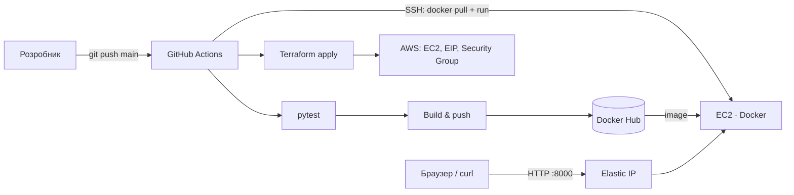

# EcoTrack — IoT Telemetry API

> Індивідуальний проєкт з DevOps: застосунок + Docker + GitHub Actions + Terraform + AWS EC2.

EcoTrack — невеликий, але повноцінний сервіс для збору телеметрії з IoT-датчиків.
Він приймає показники (температура, вологість, CO₂, PM2.5, напруга), зберігає їх
у SQLite, рахує статистику та показує все на вебдашборді. Проєкт демонструє повний
шлях від коду до працюючого контейнера на EC2, який створюється Terraform.

| | |
|---|---|
| **Стек** | Python 3.12, FastAPI, SQLite, Docker, Terraform, AWS EC2, GitHub Actions |
| **Папка** | `students/suslik/` |
| **Публічний образ** | `<DOCKER_USERNAME>/ecotrack` (Docker Hub) |
| **Порт** | `8000` |

---

## Зміст

1. [Призначення](#призначення)
2. [Архітектура](#архітектура)
3. [Структура проєкту](#структура-проєкту)
4. [Локальний запуск](#локальний-запуск)
5. [API](#api)
6. [Змінні середовища](#змінні-середовища)
7. [Тести](#тести)
8. [Інфраструктура (Terraform)](#інфраструктура-terraform)
9. [CI/CD пайплайн](#cicd-пайплайн)
10. [Одноразове налаштування репозиторію](#одноразове-налаштування-репозиторію)
11. [Перевірка після деплою](#перевірка-після-деплою)
12. [Безпека](#безпека)
13. [Вартість і прибирання ресурсів](#вартість-і-прибирання-ресурсів)
14. [Troubleshooting](#troubleshooting)
15. [Git workflow](#git-workflow)
16. [Відповідність критеріям оцінювання](#відповідність-критеріям-оцінювання)

---

## Призначення

Звичайний навчальний приклад «Hello World» не показує, як поводиться справжній
сервіс у контейнері. Тому EcoTrack — це маленький, але завершений застосунок:

- **Приймає телеметрію** через REST API з валідацією даних (Pydantic).
- **Зберігає історію** у SQLite на Docker-томі, тому дані переживають
  перезапуск контейнера.
- **Агрегує статистику**: кількість вимірювань, кількість пристроїв,
  середнє/мінімальне/максимальне значення за кожною метрикою.
- **Має вебдашборд** (HTML/CSS/JS без збірки), який автоматично оновлюється
  кожні 10 секунд і дозволяє додати показник з форми.
- **Має healthcheck** `/health`, який використовують Docker і CI/CD.
- **Розгортається автоматично**: `git push` у `main` → тести → образ у Docker Hub
  → Terraform → контейнер на EC2 → smoke-тест.

---

## Архітектура



Що відбувається під час пушу:

1. **Test** — встановлюються залежності, запускаються 8 pytest-тестів.
2. **Build & push** — Docker Buildx збирає образ і пушить два теги:
   `sha-<commit>` (незмінний, для деплою) та `latest`.
3. **Terraform apply** — створює або оновлює EC2, Elastic IP, Security Group
   і Key Pair. Стан зберігається в S3, тому повторний запуск не створює
   дубльований сервер.
4. **Deploy** — по SSH заходить на EC2, логіниться в Docker Hub, тягне образ
   `sha-<commit>`, перезапускає контейнер `ecotrack` і чистить старі образи.
5. **Smoke test** — перевіряє `http://<elastic-ip>:8000/health`, поки не отримає
   `{"status":"ok"}`.

---

## Структура проєкту

```text
students/suslik/
├── src/
│   ├── app/
│   │   ├── __init__.py          # версія застосунку
│   │   ├── config.py            # налаштування з env-змінних
│   │   ├── models.py            # Pydantic-моделі та валідація
│   │   ├── storage.py           # SQLite-репозиторій
│   │   ├── main.py              # FastAPI app factory + маршрути
│   │   └── static/              # дашборд: index.html, styles.css, app.js
│   ├── tests/test_api.py        # 8 тестів API
│   ├── requirements.txt
│   └── requirements-dev.txt
├── infra/
│   ├── versions.tf              # Terraform + AWS provider + S3 backend
│   ├── main.tf                  # EC2, EIP, Security Group, Key Pair
│   ├── variables.tf
│   ├── outputs.tf
│   ├── user_data.sh             # cloud-init: встановлення Docker
│   ├── terraform.tfvars.example
│   └── .terraform.lock.hcl      # зафіксовані версії AWS provider
├── scripts/
│   └── bootstrap-state.sh       # одноразове створення S3-бакета для state
├── Dockerfile                   # двоетапна збірка, non-root, healthcheck
├── .dockerignore
├── .gitignore
├── .env.example
├── docker-compose.yml
└── README.md
```

> **Чому workflow лежить у корені репозиторію?**
> GitHub Actions виконує лише файли з `.github/workflows/` у корені репозиторію.
> Тому `.github/workflows/ecotrack.yml` знаходиться в корені, але через
> `paths:` фільтри реагує тільки на зміни в `students/suslik/**`.

---

## Локальний запуск

### Варіант 1 — Docker (рекомендовано)

```bash
cd students/suslik

# Збірка образу
docker build -t ecotrack:local .

# Запуск із томом для SQLite та демо-даними
docker run --rm -p 8000:8000 \
  -e SEED_DEMO=true \
  -v ecotrack-data:/data \
  ecotrack:local
```

Відкрийте <http://localhost:8000> — дашборд; <http://localhost:8000/docs> —
Swagger UI.

### Варіант 2 — Docker Compose

```bash
cd students/suslik
docker compose up --build
# зупинити та видалити том із даними:
docker compose down -v
```

### Варіант 3 — без Docker (для розробки)

```bash
cd students/suslik/src
python -m venv .venv

# Linux/macOS
source .venv/bin/activate
# Windows (PowerShell)
.venv\Scripts\Activate.ps1

pip install -r requirements-dev.txt
uvicorn app.main:app --reload --port 8000
```

За замовчуванням база створюється у `src/data/ecotrack.db`. Щоб побачити
демо-дані, запустіть із `SEED_DEMO=true`.

---

## API

| Метод | Шлях | Призначення |
|---|---|---|
| `GET` | `/` | Вебдашборд |
| `GET` | `/health` | Healthcheck для Docker/CI |
| `GET` | `/docs` | Swagger UI (OpenAPI) |
| `GET` | `/api/readings?limit=50&device_id=sensor-01` | Останні вимірювання |
| `POST` | `/api/readings` | Додати вимірювання |
| `GET` | `/api/stats` | Агрегована статистика |
| `GET` | `/api/devices` | Список пристроїв |

Приклад запиту:

```bash
curl -X POST http://localhost:8000/api/readings \
  -H "Content-Type: application/json" \
  -d '{"device_id":"sensor-07","metric":"co2","value":612}'
```

Відповідь `201 Created`:

```json
{
  "device_id": "sensor-07",
  "metric": "co2",
  "value": 612.0,
  "unit": "ppm",
  "recorded_at": "2026-11-21T14:05:00Z",
  "id": 13
}
```

Допустимі метрики: `temperature`, `humidity`, `co2`, `pm25`, `voltage`.
Одиниці вимірювання підставляються автоматично, якщо не передані явно.
Невалідні дані (невідома метрика, `NaN`, некоректний `device_id`) повертають
`422 Unprocessable Entity`.

---

## Змінні середовища

Усі змінні мають безпечні значення за замовчуванням — контейнер запускається
без обов'язкових налаштувань.

| Змінна | За замовчуванням | Опис |
|---|---|---|
| `APP_ENV` | `development` | Назва середовища; у Docker-образі — `production` |
| `DATABASE_PATH` | `data/ecotrack.db` | Шлях до SQLite-файлу; у контейнері — `/data/ecotrack.db` |
| `LOG_LEVEL` | `info` | Рівень логування (`debug`, `info`, `warning`, `error`) |
| `SEED_DEMO` | `false` | `true` — додати демо-дані при першому старті |
| `MAX_READINGS_PER_REQUEST` | `200` | Максимальний `limit` для `GET /api/readings` |

Приклад файлу — `.env.example` (копіюйте у `.env`, який ігнорується Git).

---

## Тести

```bash
cd students/suslik/src
pip install -r requirements-dev.txt
pytest -q
```

Покриття: healthcheck, створення/читання вимірювань, фільтр за пристроєм,
агрегація статистики, валідація payload, віддача дашборда та статичних файлів,
OpenAPI і наповнення демо-даними. Ті самі тести виконуються в CI на кожен push
і pull request.

---

## Інфраструктура (Terraform)

### Що створюється

| Ресурс | Призначення |
|---|---|
| `aws_instance.app` | Amazon Linux 2023, `t3.micro`, gp3 8 GiB (зашифрований), IMDSv2 |
| `aws_eip.app` | Статична публічна IP-адреса |
| `aws_security_group.app` | SSH (22) для деплою + HTTP (8000) для застосунку |
| `aws_key_pair.deployer` | Публічний ключ, отриманий із `EC2_SSH_KEY_B64` |
| `user_data.sh` | Встановлює Docker, додає `ec2-user` у групу `docker` |

Terraform **не створює** VPC, subnet чи NAT Gateway — використовується
default VPC регіону, щоб проєкт залишався дешевим і простим.

> Порт застосунку задається змінною `app_port` (типово `8000`) і має збігатися
> з `-p 8000:8000` у workflow. Якщо змінюєте порт, оновіть обидва місця.

### Remote state (одноразово)

Стан зберігається в S3, щоб кожен запуск пайплайна бачив уже створені ресурси.
Створіть бакет в тому самому регіоні, що й `AWS_REGION` (ім'я має бути
унікальним у світі):

```bash
cd students/suslik
chmod +x scripts/bootstrap-state.sh
./scripts/bootstrap-state.sh ecotrack-tfstate-<ваш-унікальний-суфікс> eu-central-1
```

Скрипт вмикає версіонування, шифрування AES256 і блокує публічний доступ.
Потім додайте GitHub **repository variable** `TF_STATE_BUCKET` з ім'ям бакета.

> Скрипт розрахований на Linux/macOS/Git Bash. У PowerShell ті самі команди
> можна виконати через AWS CLI або AWS Console.

### Локальні команди

```bash
cd students/suslik/infra

terraform init \
  -backend-config="bucket=<TF_STATE_BUCKET>" \
  -backend-config="key=students/suslik/terraform.tfstate" \
  -backend-config="region=eu-central-1" \
  -backend-config="encrypt=true" \
  -backend-config="use_lockfile=true"

# Варіант із terraform.tfvars (скопіюйте terraform.tfvars.example)
terraform plan
terraform apply

# Або без tfvars:
terraform plan -var="ssh_public_key=$(cat ~/.ssh/id_ed25519.pub)"

terraform output          # public_ip, app_url, ssh_command
terraform destroy         # видалити всі ресурси
```

`use_lockfile = true` — нативне блокування стану в S3 (Terraform ≥ 1.10),
тому DynamoDB-таблиця не потрібна.

---

## CI/CD пайплайн

Файл: [`.github/workflows/ecotrack.yml`](../../.github/workflows/ecotrack.yml)

### Тригери

- `push` у `main` зі змінами в `students/suslik/**` або в самому workflow;
- `pull_request` у `main` — виконуються лише тести;
- ручний запуск через **Actions → EcoTrack CI/CD → Run workflow**.

### Етапи

| # | Job | Що робить | Секрети / змінні |
|---|---|---|---|
| 1 | `test` | Python 3.12, `pip install`, `pytest -q` | — |
| 2 | `build` | Buildx → Docker Hub, теги `sha-<commit>` і `latest`, кеш GitHub Actions | `DOCKER_USERNAME`, `DOCKER_TOKEN` |
| 3 | `terraform` | `terraform init/validate/apply`, читає `public_ip` | `AWS_ACCESS_KEY_ID`, `AWS_SECRET_ACCESS_KEY`, `EC2_SSH_KEY_B64`, `TF_STATE_BUCKET`, `AWS_REGION`, `SSH_CIDR` |
| 4 | `deploy` | SSH на EC2 → `docker login/pull/run`, рестарт контейнера | `EC2_SSH_KEY_B64`, `DOCKER_USERNAME`, `DOCKER_TOKEN` |
| 5 | smoke | `curl /health` з повторними спробами | — |

Деплой ідемпотентний: контейнер з ім'ям `ecotrack` видаляється та створюється
заново з новим тегом, дані залишаються в томі `ecotrack-data`.

### GitHub Secrets

| Назва | Що покласти |
|---|---|
| `DOCKER_USERNAME` | Логін Docker Hub |
| `DOCKER_TOKEN` | Access token Docker Hub (Read & Write) |
| `AWS_ACCESS_KEY_ID` | Access key IAM-користувача для Terraform |
| `AWS_SECRET_ACCESS_KEY` | Secret key цього користувача |
| `EC2_SSH_KEY_B64` | Приватний SSH-ключ у Base64 (без пароля) |

### GitHub Variables

| Назва | Обов'язкова | Значення |
|---|---|---|
| `TF_STATE_BUCKET` | так | Ім'я S3-бакета для Terraform state |
| `AWS_REGION` | ні | Регіон, за замовчуванням `eu-central-1` |
| `SSH_CIDR` | ні | CIDR для SSH, за замовчуванням `0.0.0.0/0` |

---

## Одноразове налаштування репозиторію

### 1. Репозиторій

1. Відкрийте шаблон курсу → **Use this template → Create a new repository**.
2. Склонуйте репозиторій і переконайтеся, що папка `students/suslik/` присутня.
3. Якщо ваше прізвище інше — перейменуйте папку та оновіть `paths:` і
   `working-directory` у workflow.

### 2. Docker Hub

1. Створіть акаунт на <https://hub.docker.com>.
2. **Account settings → Security → New access token** (права Read & Write).
3. Збережіть логін і токен — вони підуть у `DOCKER_USERNAME` / `DOCKER_TOKEN`.
4. Образ буде доступний як `<DOCKER_USERNAME>/ecotrack`.

### 3. AWS IAM

Створіть окремого IAM-користувача (не root!) з programmatic access і політикою
не ширшою, ніж потрібно:

```json
{
  "Version": "2012-10-17",
  "Statement": [
    { "Effect": "Allow", "Action": ["ec2:*"], "Resource": "*" },
    {
      "Effect": "Allow",
      "Action": [
        "s3:ListBucket",
        "s3:GetBucketLocation",
        "s3:GetBucketVersioning"
      ],
      "Resource": "arn:aws:s3:::<TF_STATE_BUCKET>"
    },
    {
      "Effect": "Allow",
      "Action": ["s3:GetObject", "s3:PutObject", "s3:DeleteObject"],
      "Resource": "arn:aws:s3:::<TF_STATE_BUCKET>/*"
    }
  ]
}
```

Збережіть `AWS_ACCESS_KEY_ID` і `AWS_SECRET_ACCESS_KEY`.

### 4. SSH-ключ

```bash
ssh-keygen -t ed25519 -C "ecotrack-deploy" -f ec2_key -N ""
base64 -w0 ec2_key > ec2_key.b64        # Linux
# macOS: base64 -i ec2_key -o ec2_key.b64
```

Windows PowerShell:

```powershell
ssh-keygen -t ed25519 -C "ecotrack-deploy" -f ec2_key -N '""'
[Convert]::ToBase64String([IO.File]::ReadAllBytes("ec2_key")) |
  Set-Content -NoNewline ec2_key.b64
```

Вміст `ec2_key.b64` → secret `EC2_SSH_KEY_B64`. Приватний ключ і `.b64`
**не комітяться** (додані в `.gitignore`). Публічний ключ CI отримує сам:
`ssh-keygen -y -f ec2_key`.

### 5. S3-бакет для state

Виконайте `scripts/bootstrap-state.sh` (див. розділ Terraform) і додайте
repository variable `TF_STATE_BUCKET`.

### 6. Секрети у GitHub

**Settings → Secrets and variables → Actions**:

- Secrets: `DOCKER_USERNAME`, `DOCKER_TOKEN`, `AWS_ACCESS_KEY_ID`,
  `AWS_SECRET_ACCESS_KEY`, `EC2_SSH_KEY_B64`.
- Variables: `TF_STATE_BUCKET`, за бажанням `AWS_REGION`, `SSH_CIDR`.

Після цього будь-який push у `main` запускає повний пайплайн.

---

## Перевірка після деплою

1. **Actions** — усі jobs зелені, в логах `deploy` є `Health check passed`.
2. **Terraform output** — `app_url` виглядає як `http://<ip>:8000`.
3. Відкрийте `app_url` у браузері: дашборд показує демо-дані (якщо
   `SEED_DEMO=true`), форма додає нові вимірювання.
4. Перевірка API:

   ```bash
   curl http://<elastic-ip>:8000/health
   curl http://<elastic-ip>:8000/api/stats
   ```

5. На сервері (за потреби):

   ```bash
   ssh -i ec2_key ec2-user@<elastic-ip>
   docker ps
   docker logs --tail 50 ecotrack
   ```

---

## Безпека

- Секрети зберігаються лише в GitHub Secrets; у репозиторії немає ключів,
  `.env`, `terraform.tfvars` і `*.tfstate`.
- `.gitignore` і `.dockerignore` виключають ключі, бази, кеші та state-файли.
- Контейнер працює від непривілейованого користувача `app`.
- EC2 використовує IMDSv2 (`http_tokens = "required"`), root-том зашифрований.
- Docker Hub-токен має мінімально достатні права (Read & Write).
- **Обмежте SSH**: за замовчуванням `SSH_CIDR=0.0.0.0/0`, бо IP runner'ів
  GitHub змінюються. Для постійного використання задайте repository variable
  `SSH_CIDR` зі своєю IP (`x.x.x.x/32`) або діапазонами GitHub Actions.
- Після завершення роботи виконайте `terraform destroy`.

---

## Вартість і прибирання ресурсів

Проєкт розрахований на безкоштовний tier / мінімальні витрати: `t3.micro`,
8 GiB gp3, Elastic IP. Публічна IPv4-адреса та EBS можуть тарифікуватися.

```bash
cd students/suslik/infra
terraform destroy \
  -var="ssh_public_key=$(cat ~/.ssh/id_ed25519.pub)" \
  -var="aws_region=eu-central-1"
```

Після `destroy` видаліть S3-бакет стану, якщо він більше не потрібен:

```bash
aws s3 rb s3://<TF_STATE_BUCKET> --force
```

---

## Troubleshooting

| Симптом | Причина / рішення |
|---|---|
| `terraform init`: bucket does not exist | Не створено S3-бакет або неправильний `TF_STATE_BUCKET` |
| `Error acquiring the state lock` | Попередній запуск перервався; перевірте, що ніхто не виконує apply, і видаліть `*.tflock` у бакеті |
| `use_lockfile` is not supported | Terraform < 1.10; у CI зафіксовано 1.10.5 |
| Deploy: `Permission denied (publickey)` | `EC2_SSH_KEY_B64` містить не той ключ або ключ захищений паролем; перевірте, що це саме приватний ключ від поточного `ec2_key` |
| Deploy: SSH timeout | Security Group не пропускає 22 з runner'а (`SSH_CIDR`), інстанс ще стартує |
| `docker login`: unauthorized | Перевірте `DOCKER_USERNAME` і токен (не пароль), права Read & Write |
| Контейнер падає одразу | `docker logs ecotrack`; найчастіше — права на `/data` або зайнятий порт |
| `/health` не відповідає | Контейнер не запустився, порт 8000 не відкритий у SG, або ще йде старт |
| Healthcheck у Docker `unhealthy` | Перевірте `docker inspect ecotrack`; застосунок слухає `0.0.0.0:8000` |
| `terraform apply` створює новий інстанс | State втрачено (наприклад, інший bucket/key) — перевірте backend |
| Windows: `docker`/`terraform` не знайдено | Встановіть Docker Desktop / Terraform і перезапустіть термінал |

---

## Git workflow

- Основна гілка — `main`; прямі пуші в неї заборонені (protected branch).
- Робота ведеться у коротких гілках: `feature/app`, `feature/docker`,
  `feature/infra`, `feature/ci`, `docs/readme`.
- Коміти — у стилі Conventional Commits (`feat:`, `fix:`, `ci:`, `docs:`,
  `chore:`), маленькі та логічно завершені.
- Гілки зливаються в `main` через Pull Request і merge commit (`--no-ff`),
  після чого видаляються.
- Реліз позначається тегом, наприклад `v1.0.0`.

---

## Відповідність критеріям оцінювання

| Критерій | Де реалізовано |
|---|---|
| CI/CD від пушу в `main` до деплою | `.github/workflows/ecotrack.yml`: jobs `test → build → terraform → deploy → smoke` |
| Застосунок у контейнері на EC2 | `deploy` job: `docker pull` + `docker run --restart unless-stopped` |
| Образ збирається й пушиться в Docker Hub | `build` job, `docker/build-push-action@v6`, теги `sha-<commit>` і `latest` |
| Інфраструктура автоматично через Terraform | `infra/`: EC2, EIP, SG, Key Pair; `terraform apply` у CI, state в S3 |
| `.gitignore` налаштований | `students/suslik/.gitignore`: ключі, `.env`, `.terraform/`, `*.tfstate`, БД, кеші |
| Dockerfile оптимізований | двоетапна збірка, кеш залежностей, `--no-cache-dir`, non-root, healthcheck |
| Структура коду й коміти | `src/app` розділено на config/models/storage/main, тести, Conventional Commits |
| Гілки та історія | feature-гілки + merge commits у `main`, тег `v1.0.0` |
| README описує пайплайн | розділи «Архітектура», «CI/CD пайплайн», «Одноразове налаштування» |
| Якісна документація | таблиці змінних/секретів, приклади curl, troubleshooting, схема |
